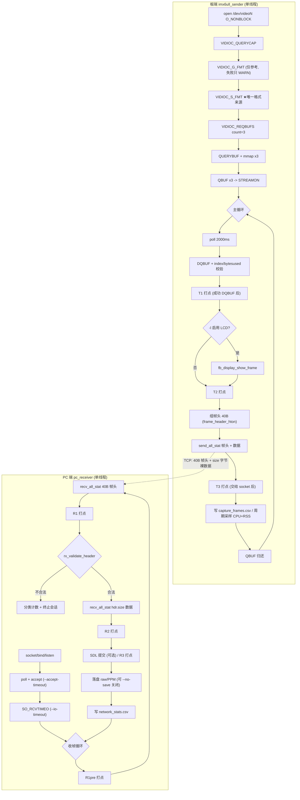

# 源码审计与改动记录 (AUDIT_AND_CHANGES)

> 本文由原 `source_audit.md` 与 `modification_report.md` **深度合并**而成（2026-10-13）。
> - **A 部分 = 源码审计**：文件↔行号映射、问题清单、GT911 集成审计
> - **B 部分 = 改动记录**：改了什么、为什么、怎么验证
>
> 章节编号已加部件前缀（`§A6.2` / `§B2.1`），**全文编号唯一**，可直接交叉引用。
> 想快速上手请看 `USAGE.md`；要看数据看 `PERFORMANCE.md`；要写简历看 `RESUME.md`。

---

# A 部分 源码审计


- 项目: `imx6ull_ov5640_v4l2_tcp` — i.MX6ULL / OV5640 V4L2 MMAP 采集 → TCP → PC 显示
- 项目根目录: `/home/why/zdyz/linux/IMX6ULL/Projects/imx6ull_ov5640_v4l2_tcp`
- 内核树: `/home/why/zdyz/alientek_linux/linux-imx-rel_imx_4.1.15_2.1.0_ga_alientek`
- 审计方式: 逐文件阅读 + `grep` 行号定位 + 内核驱动源码交叉核对 + PC 侧可执行测试验证
- 审计日期: 2026-10-11
- 行号基准: **本次修改后**的源码（含新增统计代码）；改动前基线行号在括号内注明

> 结论先行: 项目是**单线程**的 DQBUF→显示→发送→QBUF 串行循环, 传输协议是**自定义 40 字节帧头 + 裸图像数据**, 没有 CRC/分片序号, 也没有任何性能统计。本次改动集中在"加统计 + 修一个真实的字节序缺陷 + 消除无限阻塞", 未改动内核驱动。

---

## A1. 文件清单与实际角色

| 文件 | 行数 | 角色 | 是否参与构建 |
|---|---|---|---|
| `src/v4l2_capture.c` | 685 | V4L2 MMAP 采集库 (open→QUERYCAP→S_FMT→**S_PARM/G_PARM**→REQBUFS→mmap→QBUF→STREAMON→poll→DQBUF) | ARM + PC 各自编译一份 |
| `src/imx6ull_sender.c` | 1108 | **板端主程序**: 采集 + 可选 LCD 显示 + TCP 发送 | ARM |
| `src/pc_receiver.c` | 1049 | **PC 端主程序**: TCP 接收 + 可选 SDL2 显示 + 落盘 raw/PPM | PC |
| `src/tcp_socket.c` | 261 | `send_all`/`recv_all`/连接/监听/超时设置 | ARM + PC |
| `src/fb_display.c` | 396 | `/dev/fb0` framebuffer 显示 (YUV/RGB565 → XRGB8888) | ARM |
| `src/metrics.c` | 320 | **新增**: 统计模块 (分位/CPU/RSS/CSV) | ARM + PC |
| ~~`src/v4l2_info.c`~~ | ~~68~~ | **已于 2026-10-13 删除**（历史遗留, 从未参与构建; 备份 `~/backup/imx6ull_cleanup_20261013/`） | — |
| ~~`tools/v4l2_info.c`~~ | ~~335~~ | **已于 2026-10-13 删除**（板端诊断工具，职责已由 `imx6ull_sender` 启动日志承担） | — |
| ~~`tools/v4l2_format_test.c`~~ | ~~305~~ | **已于 2026-10-13 删除**（同上；备份 `~/backup/imx6ull_cleanup_20261013/tools/`） | — |

| `include/v4l2_capture.h` | 178 | 采集 API + `struct v4l2_frame` / `struct v4l2_init_params` | — |
| `include/fb_display.h` | 98 | 显示 API + `swap_rb` 开关 | — |
| `include/metrics.h` | 122 | **新增**: 统计模块 API | — |
| `include/frame_proto.h` | 250 | 帧协议定义 + **新增**统一序列化 `frame_header_hton/ntoh` | ARM + PC |

构建系统: `Makefile` 目标 `arm` / `pc` / `allboth` / `install` / `clean`
（原 `arm-tools` 目标随两个诊断工具于 2026-10-13 一并删除）。

> **关于测试工具的说明**: 本次审计与修复过程中曾使用两个纯 PC 侧工具
> （帧协议单元测试、可控分块/畸形帧发送器）作为验证手段。因为项目现已具备
> 开发板实测条件、且目标是"只保留可连板真实测试的工具"，这两个工具已在
> 2026-10-13 移出项目（备份于 `~/backup/imx6ull_offline_tests_20261013/`）。
> **它们得出的结论仍然有效并保留在下文**，只是不再有可运行的工具与原始日志。
工具链: `arm-linux-gnueabihf-gcc 4.9.4 (Linaro)`; PC: `gcc 11.4.0`; SDL2 `2.0.20`。
NFS 安装路径 (`install`): `/home/why/zdyz/nfs/rootfs/lib/modules/4.1.15`。

---

## A2. V4L2 采集流程 — 文件:行号映射

以下行号对应 `src/v4l2_capture.c`（改动后）。

| 步骤 | 函数 | 行号 | 说明 |
|---|---|---|---|
| ioctl 封装 | `xioctl` | 31 | EINTR 自动重试 |
| 打开设备 | `v4l2_init` | 49 | `open(O_RDWR\|O_NONBLOCK)` 第 62 行 |
| QUERYCAP | 同上 | 72 | 校验 `V4L2_CAP_VIDEO_CAPTURE` (80) / `STREAMING` (85) |
| G_FMT (只读初始值) | 同上 | 100 | **失败只 WARN, 不致命**; 无效值回退 640x480/RGB565 (107-112) |
| S_FMT | 同上 | 128 | **唯一权威格式来源** |
| 采纳 S_FMT 结果 | 同上 | 138-142 | 写入 `ctx.width/height/pixfmt/bytesperline/sizeimage` |
| **S_PARM (请求帧率, 可选)** | `v4l2_init_ex` | 见 `v4l2_request_fps` | `--set-fps`; 必须在 S_FMT 之后、STREAMON 之前; 驱动不支持只 WARN |
| **G_PARM (读回实际帧率)** | `v4l2_init_ex` | 见 `v4l2_read_parm` | 填 `ctx.fps_num/fps_den/fps_supported`, **报告中的帧率以此为准** |
| REQBUFS (count=`--buffers` 或 3) | 同上 | 见 `req.count =` | 数量可调, 用于验证"缓冲不足导致溢出" |
| QUERYBUF | 同上 | 194 | 取 `buf.length` 存 `ctx.buf_len[i]` (200) |
| mmap | 同上 | 201 | `PROT_READ\|PROT_WRITE, MAP_SHARED` |
| QBUF (首次入队) | 同上 | 214 | 3 个缓冲全部入队 |
| STREAMON | 同上 | 224 | |
| poll | `v4l2_get_frame_info` | 257 / poll 在 271 | 超时 2000ms 由调用者传 |
| DQBUF | 同上 | 296 | EAGAIN 返回 `-EAGAIN` (304), 其他错误返回 -1 |
| index 合法性校验 | 同上 | 313 | `buf.index >= ctx->nbufs` → 报错返回 -1 |
| **`bytesused > mapped_len` 校验 (新增)** | 同上 | 318-325 | 越界读保护, 丢弃该帧并报错 |
| 输出元信息 | 同上 | 327-333 | `data/bytesused/buf_len/index/sequence/flags/timestamp_us` |
| 兼容旧接口 | `v4l2_get_frame` | 334 | 内部调用 `v4l2_get_frame_info` |
| QBUF (归还) | `v4l2_put_frame` | 353 | |
| STREAMOFF | `v4l2_deinit` | 373 / 380 | |
| munmap | 同上 | 387-395 | |
| close | 同上 | 398 | |
| 能力打印 | `v4l2_print_capabilities` | 409 | QUERYCAP/G_FMT/G_PARM/ENUM_FMT/ENUM_FRAMESIZES/ENUM_FRAMEINTERVALS |

### A2.1 缓冲区管理方式

- Buffer 数量: `REQBUFS.count = 3`, 上限 `V4L2_MAX_BUFFERS = 8`。
- 每个 buffer 的用户态指针: `ctx.buf_mmap[i]`, 长度 `ctx.buf_len[i]`（`include/v4l2_capture.h:24-34`）。
- 数据生命周期: DQBUF 拿到 index → 使用 `ctx.buf_mmap[index]` → **用完立刻 QBUF**。
- 旧代码 `v4l2_get_frame` **丢弃了 `sequence` 和 `flags`**, 因此无法判断驱动侧是否跳帧。改动后 `v4l2_get_frame_info` 把二者带出来。

### A2.2 为什么"跨线程引用已 QBUF 的地址"在这里不成立

板端 `imx6ull_sender.c` 的循环顺序是:

```
DQBUF → (可选 LCD 转换) → send(帧头) → send(帧数据) → QBUF
```

即 **`send_all` 在 `v4l2_put_frame` 之前完成**, 发送期间该 buffer 从未归还驱动, 内核不会把它重新拿去 DMA。所以当前架构**不存在**"异步发送仍引用已 QBUF 指针"的竞态。

代价是**采集与发送被串行化**: 若单帧发送耗时超过 2 个帧周期, 另外两个缓冲会被写满并溢出。3 缓冲只能吸收约 2 帧的发送抖动。这一点已在 `imx6ull_sender.c` 循环前的注释中被原文过度乐观地表述为"采集不会因为网络发送而停顿", 属于**需要实测确认的假设**, 本次不改架构, 而是用 `capture-only` vs `capture+tcp` 两组数据去检验它。

---

## A3. TCP 帧协议审计

协议定义: `include/frame_proto.h`。`struct frame_header` = 40 字节, 无 padding。

| 字段 | 偏移 | 类型 | 说明 |
|---|---|---|---|
| `magic` | 0 | u32 | `FRAME_MAGIC = 0x12345678` |
| `version` | 4 | u32 | **原为 1, 本次改为 2**（原因见 §3.1） |
| `header_size` | 8 | u32 | `sizeof(struct)` = 40 |
| `width` | 12 | u32 | |
| `height` | 16 | u32 | |
| `pixfmt` | 20 | u32 | FOURCC |
| `size` | 24 | u32 | 后续图像字节数 |
| `frame_id` | 28 | u32 | 发送端整帧成功后才 +1 |
| `timestamp_us` | 32 | u64 | 来自 V4L2 buffer timestamp |

### A3.1 发现并修复的缺陷: `timestamp_us` 的线上编码不是平台无关的

**旧实现**（原 `imx6ull_sender.c` 的 `send_frame_header`）:

```c
net_hdr.timestamp_us =
    (((uint64_t)htonl((uint32_t)(hdr->timestamp_us >> 32))) << 32)
    | htonl((uint32_t)(hdr->timestamp_us & 0xffffffff));
```

这是用**整数拼接**去"序列化" 64 位字段。`htonl` 返回的是数值, 把它左移 32 位再存进内存时, 落盘字节取决于主机字节序:

- 小端主机 (i.MX6ULL / x86): 内存字节 = `[BE(lo)][BE(hi)]`
- 大端主机: 内存字节 = `[BE(hi)][BE(lo)]`

即**同一份代码在不同字节序平台上产生不同线格式**, 违反"网络字节序"约定。接收端用了对称的错法, 所以小端↔小端能"收得对", 掩盖了问题。

**证据**（同一 `timestamp_us = 0x00000001FFFFFFFF` 的实测内存转储；由已移出的协议单元测试产生）:

```
      legacy v1 ts bytes: FF FF FF FF 00 00 00 01     <- 低 32 位跑到了前面
      fixed  v2 ts bytes: 00 00 00 01 FF FF FF FF     <- 正确的大端 64 位
```

> 该结论不依赖工具即可核对: `include/frame_proto.h` 的 `frame_header_hton()`
> 现在是**逐字节**写 `ts[0..3] = BE(hi)`、`ts[4..7] = BE(lo)`, 读代码即可确认
> 与主机字节序无关。

**修复**: 在 `frame_proto.h` 里提供唯一一份 `frame_header_hton()` / `frame_header_ntoh()`, 64 位字段**逐字节**写出高 32 位再写低 32 位, 与主机字节序无关。发送端与接收端全部改为调用这同一份实现（顺手消除了"两端各写一份容易写歪"的结构性风险）。

**协议版本**: 因为线格式确实变了, `FRAME_VERSION` 由 1 提升为 2。新接收端会把版本 1 的帧判为 `bad_version` 并明确报错, 而不是静默算出错误的微秒时间戳。
→ **升级时必须同时重新编译并部署板端与 PC 端**。若想临时兼容旧板端二进制, 把 `include/frame_proto.h` 的 `FRAME_VERSION` 改回 1 并把 `frame_header_hton/ntoh` 的 64 位部分换回旧写法即可(不推荐)。

### A3.2 短收发处理 (已存在, 本次补充量化)

- `send_all_stat` (`src/tcp_socket.c:26`): `while (remaining > 0)` 循环补齐; `EINTR` 重试; `n == 0` 视为对端关闭; 使用 `MSG_NOSIGNAL` 避免 `SIGPIPE` 杀进程。
- `recv_all_stat` (`src/tcp_socket.c:81`): 同样循环补齐; `n == 0` 表示对端断开。
- **新增**: `struct io_stats` 记录 `calls / partial / bytes / eintr / timeouts / errors`, 把"TCP 没有消息边界"这件事变成可读数字。逐字节发送时的实测证据见 `PERFORMANCE.md`。

### A3.3 接收端帧头校验 (本次增强)

原实现**只校验 `magic`**。新增 `rx_validate_header()` (`src/pc_receiver.c:702`), 检查:

| 检查 | 失败计数 | 说明 |
|---|---|---|
| `magic != FRAME_MAGIC` | `bad_magic` | |
| `version != FRAME_VERSION` | `bad_version` | 协议版本错 (如旧二进制混用) |
| `header_size != 40` | `bad_hdr_size` | 布局错 |
| `size == 0` 或 `size > 64MB` | `bad_size` | **防止畸形帧头把 `realloc` 撑爆** |
| `width/height == 0` 或 `> 8192` | `bad_geometry` | |
| 非 MJPEG 且 `size < width*2` | `bad_size` | 数据量覆盖不了一行, 明显不合理 |

任一不通过即终止会话（帧边界已不可信, 继续读只会得到垃圾）并计入对应计数器。

**仍未解决的协议级缺口**（如实记录, 未改动）:
- 没有 CRC / 校验和 → **只能声称"完成 N 帧协议级重组", 不能声称"内容 100% 正确"**。
- 没有 `bytesperline` 字段 → PC 端解码/PPM 只能按 `width*2` 紧凑步长假设（`src/pc_receiver.c:196-204` 注释已说明）。若驱动返回 `bytesperline != width*2`（行尾 padding），PC 端会错行。
- `frame_id` 只在整帧发送成功后才 +1, 所以接收端的 frame_id 缺口 = "发送端未完成整帧协议发送的帧数", **不能等同于硬件丢帧**。

---

## A4. 显示路径审计

### A4.1 板端 framebuffer (`src/fb_display.c`)

| 项 | 位置 | 结论 |
|---|---|---|
| `FBIOGET_VSCREENINFO` | 51 | 取 `xres/yres/bits_per_pixel/red.offset/...` |
| `FBIOGET_FSCREENINFO` | 59 | 取 **`fix.line_length`** 与 `smem_len` |
| 位深限制 | 85 | 只支持 32bpp, 其他直接初始化失败（比"用错每像素字节数写显存"安全） |
| mmap | 95 | `MAP_SHARED` |
| 目标行步长 | 194 / 250 | **用 `fb->line_length`, 未假设 `width*4`** ✅ |
| 源行步长 | 191 / 247 | 用调用者传入的 `src_stride`（板端传 `ctx.bytesperline`）✅ |
| RGB565 转换 | 179 | `uint16_t` 直接取字 → 隐含主机小端假设; **新增 `swap_rb` 分支**（`--lcd-swap-rb`, 默认关闭 = 原行为）用两个独立循环实现, 默认路径零额外开销 |
| YUYV 转换 | 223 | 按 `[Y0,U,Y1,V]` 分组, 起点对齐到偶数 (235) |
| 居中/裁剪 | 298-316 | 图像<屏幕居中, >屏幕居中裁剪 |

**发现的问题（未修改, 记录）**:
1. `fb_copy_rgb565_to_xrgb8888` 用 `uint16_t` 直接读源数据, 隐含"源是小端 16bpp"。在 i.MX6ULL(LE) 上成立, 但注释里应显式说明。
2. `RGB565` 路径**没有做 R/B 交换**, 而 README 记录的实际现象是"i.MX6ULL CSI 输出 RGB565 时 R/B 通道交换"。也就是说**板端 LCD 用 RGB565 直显时颜色会偏蓝绿, 而 PC 端用 BGR565 解码才是正常色**——同一份数据两端显示不一致。这是一个待确认的实际缺陷（需上板目视确认），本次未改动。

### A4.2 PC 端 SDL2 (`src/pc_receiver.c`)

| 项 | 位置 | 结论 |
|---|---|---|
| 纹理格式 | 259 | 固定 `SDL_PIXELFORMAT_RGB24` |
| 纹理更新 | 337 | **逐行** `SDL_UpdateTexture(..., 1 行 ..., rgb_line, width*3)` |
| pitch | 337 | 用 `d->width*3` 作为 RGB24 行 pitch — 与纹理宽度自洽 ✅ |
| 源步长 | 337 | `data + y*d->width*2` → **硬编码 `width*2`, 未使用 `bytesperline`** ⚠️ 同 §3.3 |
| 事件处理 | 278 | 数字键 1-8 切换解码格式, 0=auto, ESC/Q 退出 |

---

## A5. 内核与设备树审计（只读, 未修改）

### A5.1 文件位置

```
drivers/media/platform/mxc/subdev/mx6s_capture.c    (2136 行, CSI 控制器, 驱动名 mx6s-csi)
drivers/media/platform/mxc/subdev/ov5640.c          (Sensor subdev)
drivers/media/platform/mxc/ov5640.c                 (另一份实现, 未使用)
arch/arm/boot/dts/imx6ull-alientek-emmc.dts         (板级设备树)
```

### A5.2 驱动配置确认（`.config`）

| 配置项 | 值 | 含义 |
|---|---|---|
| `CONFIG_VIDEO_MXC_CSI_CAMERA` | `=m` | CSI 控制器编为模块 |
| `CONFIG_MXC_CAMERA_OV5640` | `=m` | OV5640 并行接口驱动 |
| `CONFIG_MXC_CAMERA_OV5640_MIPI` | 未设置 | **确认走 8-bit 并行 DVP, 不是 MIPI** |

### A5.3 设备树节点

| 节点 | 行号 | 关键属性 |
|---|---|---|
| `&csi` | 228 | `status="okay"`, endpoint → `ov5640_ep` |
| `ov5640: ov5640@3c` (挂在 i2c2) | 357 | `compatible="ovti,ov5640"`, `reg=<0x3c>`, `pwn-gpios=<&gpio1 4 1>`, `rst-gpios=<&gpio1 2 0>`, `csi_id=<0>`, `mclk=<24000000>`, `mclk_source=<0>` |
| `csi_pwn_rst` | 433 | GPIO1_IO02(reset) / GPIO1_IO04(电源) |
| `pinctrl_csi1` | 442 | CSI_MCLK / PIXCLK / VSYNC / HSYNC / DATA00-07, 注释注明 **100K PD, MCLK 关闭时 LED 熄灭**（MCLK 与闪光灯 LED 共用引脚） |

### A5.4 关于 `mx6s_csi G_FMT` 问题 — 定性为「已定位 + 云侧修复 + 应用层规避」，非本次修改

驱动实现 (`mx6s_capture.c:1605-1615`):

```c
static int mx6s_vidioc_g_fmt_vid_cap(...)
{
    f->fmt.pix = csi_dev->pix;      /* 只把内部状态拷回去 */
    return 0;
}
```

- **根因**: 原厂驱动的 probe 从不初始化 `csi_dev->pix`, 只有 S_FMT 才填充它 (`:1592 csi_dev->pix = f->fmt.pix`)。因此 **S_FMT 之前**调用 G_FMT 会拿到全零的 `pixelformat/bytesperline`。这是**原厂驱动缺陷**, 不是时序偶发。
- **当前内核树状态**: probe 已在 `:2007-2013` 显式初始化默认格式 (`640x480 / YUYV / bytesperline=1280 / sizeimage=614400`)。**说明该问题在本内核树上已被修复**（修复方式属于驱动侧改动, 早于本次审计）, 因此现在 S_FMT 之前调 G_FMT 也能拿到有效值。
- **应用层策略**（`v4l2_capture.c:92-160`）: 仍然坚持"**以 S_FMT 返回值为唯一格式来源**, G_FMT 只作参考、失败只 WARN"。这是对驱动行为的防御性设计, 与驱动是否修好无关, 保留是正确的。
- **本次未修改任何内核代码**。审计期间确认的其余驱动改动（`try_fmt` 改调 `try_mbus_fmt`、start_streaming 重排等）已存在于内核树中, 属于既有状态。

**因此简历与报告中必须表述为**: G_FMT 问题"**定位到原厂驱动的 probe 未初始化 `csi_dev->pix`, 内核树中已做 probe 初始化修复, 应用层以 S_FMT 为准做规避**"。不可声称"本次修复并验证", 也不可声称"仅定位未解决"。

### A5.5 采集设备节点

历史记录为 `/dev/video1`(板端 sender 默认值)。**上板必须先确认**:

```bash
v4l2-ctl --list-devices      # 若板上有 v4l2-utils
./imx6ull_sender -d /dev/video1 --capture-only -n 1   # 启动日志给出驱动/格式/帧率
```
以 `VIDIOC_QUERYCAP` 返回的 `driver=mx6s-csi` 为准。

---

## A6. 改动前存在的问题清单（按严重度）

| # | 严重度 | 问题 | 位置 | 本次处理 |
|---|---|---|---|---|
| 1 | **高** | `timestamp_us` 线格式随主机字节序变化 | `frame_proto.h` / 原 `send_frame_header` | **已修复**, 版本升到 2 |
| 2 | **高** | 接收端只校验 `magic`, 畸形 `size` 可导致超大 `realloc` | `pc_receiver.c` | **已修复**, 6 类校验 + 分类计数 |
| 3 | **高** | `accept()` 无限阻塞, 自动化测试会永久挂死 | `pc_receiver.c` | **已修复**, `--accept-timeout` |
| 4 | 中 | `send`/`recv` 无超时, 对端挂起时本端永久阻塞 | `tcp_socket.c` | **已修复**, `--io-timeout` → `SO_SNDTIMEO`/`SO_RCVTIMEO` |
| 5 | 中 | `bytesused` 未与映射长度比对, 越界读风险 | `v4l2_capture.c` | **已修复**, 新增校验并丢弃越界帧 |
| 6 | 中 | `sequence`/`flags` 被丢弃, 无法判断驱动跳帧 | `v4l2_capture.c` | **已修复**, `v4l2_get_frame_info` 暴露 |
| 7 | 中 | 无任何性能统计, 简历/报告无可量化依据 | 全部 | **已修复**, `metrics.c` + `--stats-dir` |
| 8 | 中 | stdout 重定向时块缓冲, 日志不及时落盘（曾导致误判"卡死"） | 两个 main | **已修复**, `setvbuf(_IOLBF)` |
| 9 | 中 | 板端 RGB565 直显不做 R/B 交换, 与 PC 端推荐解码不一致 | `fb_display.c` RGB565 转换 | **已提供开关** `--lcd-swap-rb`（默认不变）; **定性结论仍需上板目视** |
| 10 | 低 | 协议无 CRC / 无 `bytesperline` 字段 | `frame_proto.h` | **未处理**, 只在报告中如实说明限制 |
| 11 | 低 | 采集与发送串行, 3 缓冲仅吸收约 2 帧抖动 | `imx6ull_sender.c` 主循环 | **未改架构**, 但已提供 `--buffers` 与 `capture-only` 对照实验手段 |
| 12 | 低 | `v4l2_get_frame_info` 在 index 非法时该 buffer 未归还, 队列可能饿死 | `v4l2_capture.c` index 校验处 | **未处理**（正确做法是重启队列, 属驱动异常兜底） |
| 13 | 低 | `src/v4l2_info.c` 与 `tools/v4l2_info.c` 重复, 前者不参与构建 | — | **已处理（2026-10-13 删除死文件）** |
| 14 | 低 | `fb_display.c` 三个 clamp `if` 连写一行, gcc ≥6 报 `-Wmisleading-indentation`（**既有问题, 非本次引入**） | `src/fb_display.c` `fb_copy_yuyv_to_rgb888` | **已修复**, 拆成多行, 语义不变 |
| 15 | 中 | 帧率不可协商 → 无法判断"这个速率是驱动给的还是请求的", 也做不了带宽对照实验 | `v4l2_capture.c` | **已修复**, `--set-fps` → `S_PARM`/`G_PARM` |
| 16 | 中 | `REQBUFS.count` 硬编码 3, 无法验证"缓冲不足导致溢出" | `v4l2_capture.c` | **已修复**, `--buffers` |
| 17 | 中 | 短运行（< 一个采样间隔）拿不到 CPU/RSS, 输出 `cpu=-1, rss=0` | `metrics.c` 使用方式 | **已修复**, 运行首尾各补采一次 |
| 18 | 低 | `recv_timeouts` 只打印未落盘 | `pc_receiver.c` | **已修复**, 入 `summary.csv` |
| 19 | **高** | `fb_display.c` **硬编码只支持 32bpp**, 其他位深直接初始化失败。目标板常见 1024×600 **16bpp** 屏 → `-l` 会静默失败, 双指缩放功能无处显示 | `fb_display.c` | **已修复**, 放开到 16/32bpp + 按 `offset/length` 通用打包 |
| 20 | 中 | 触摸坐标范围 (1024×600) 与 LCD 分辨率未必一致, 且 `/dev/input/eventX` 编号不固定 | 新模块 | **已处理**, `EVIOCGABS` 读真实范围 + 跨度映射 + 自动扫描 event0..9 |
| 21 | 中 | `SYN_DROPPED` 会造成"幽灵触点" | 新模块 | **已处理**, 清空 slot + 终止手势会话 + 计数 |

### A6.1 GT911 双指手势缩放集成审计（本轮新增功能）

**GT911 侧源码位置**（任务书给的路径是相对路径，实际根目录经搜索确认）：

```
/home/why/zdyz/linux/IMX6ULL/Projects/-i.MX6ULL-IIO-LCD-/
  kernel_drivers/gt911_ts/lcd.c      (601 行, 触摸驱动, 本轮 0 改动)
  user_app/touch_sensor_scope.c      (1131 行, 已有手势引擎, 只读参考其阈值设计)
  user_app/fb_draw.c / fb_draw.h     (提供 16/32bpp 参考, 据此发现缺口 #19)
  tools/mt_event_sim.c               (376 行, 合成 MT 事件工具, 事件日志格式一致)
```

**驱动能力核对（决定用户态怎么写）**：

| 事实 | 位置 | 对用户态的影响 |
|---|---|---|
| `idev->name = "GT911 Touchscreen"`, `BUS_I2C` | `lcd.c:271-272` | 上板据此确认设备 |
| `input_mt_init_slots(5, INPUT_MT_DIRECT\|INPUT_MT_DROP_UNUSED)` | `lcd.c:286` | **MT Protocol B**; 未上报的 slot 由内核自动补 `TRACKING_ID=-1` |
| `ABS_MT_POSITION_X ∈ [0,1024]`, `Y ∈ [0,600]` | `lcd.c:277-278` | 坐标必须映射, 不能当 LCD 像素直接用 |
| 开启 pointer emulation(`ABS_X/Y`+`BTN_TOUCH`) | `lcd.c:276,282-283` | 释放语义**只认** `TRACKING_ID=-1` |
| **未上报** `ABS_MT_PRESSURE`/`ABS_MT_ORIENTATION` | — | 手势只能基于触点数量 + 位置 |
| 驱动**不产生** `SYN_DROPPED`（内核 core 补发） | — | 用户态必须自己防 |

**审计结论**：驱动实现正确完整，用户态只依赖
`ABS_MT_SLOT / TRACKING_ID / POSITION_X,Y / SYN_REPORT` 即可可靠还原触点集合，**无需改驱动**。

**新增文件**：

| 文件 | 行数 | 作用 |
|---|---|---|
| `include/touch_input.h` / `src/touch_input.c` | 155 / 419 | evdev 读取 + MT-B 状态机; 支持离线回放（**与真实设备共用同一套状态机**） |
| `include/gesture_zoom.h` / `src/gesture_zoom.c` | 116 / 316 | 双指手势 → 缩放视图; 防抖、边界钳制、统计 |
| `scripts/board_zoom_bench.sh` | — | 板端 1.0/1.5/2.0× 倍率矩阵 |

> 缩放/手势的**离线**测试工具（合成事件生成 + 回放 + 合成 framebuffer 渲染基准）
> 已于 2026-10-13 移出项目（备份于 `~/backup/imx6ull_zoom_offline_tests_20261013/`），
> `Makefile` 的 `pc-tests` 目标同步撤销。它们得出的结论保留在
> `PERFORMANCE.md` §Z3 中，但**不再有可运行工具与原始日志**。

**修改文件**: `include/fb_display.h`（`struct fb_view` + 缩放 API）、`src/fb_display.c`（16/32bpp + 最近邻缩放渲染）、`src/imx6ull_sender.c`（9 个开关 + 集成 + 统计埋点）、`Makefile`。

**未改动**: GT911 驱动、设备树、OV5640/CSI 驱动、`v4l2_capture.c`（**MMAP 与 QBUF/DQBUF 轮转完全不变**）、`tcp_socket.c`、`pc_receiver.c`。

详细实施与验证结论见 `PERFORMANCE.md`。

### A6.2 关于 `fb_display.c` 的 `-Wmisleading-indentation`（已修复）

ARM 交叉编译（`gcc 4.9.4`）**不报**此告警; 用 `gcc 11.4` 编译同一份源码时会报:

```
src/fb_display.c:154:25: warning: this ‘if’ clause does not guard... [-Wmisleading-indentation]
  154 |     if (*b < 0) *b = 0; if (*b > 255) *b = 255;
      |                         ^~
```

**语义上不是 bug** —— 两个 `if` 各自只保护一条语句, 逻辑正确, 只是缩进有误导性。
该文件在第二轮改动中已顺手拆成多行, 现在用 gcc 11 编译也是 0 warning; 语义完全不变。
**注意**: 正常的 `make arm` / `make pc`（PC 端不编译 `fb_display.c`）本来就都是 **0 warning**; 此告警只在"把 `fb_display.c` 也拿 gcc 11 编译"的额外冒烟测试中出现。

---

## A7. 新增计数器归属表（哪些已有 / 哪些新增）

| 指标 | 改动前 | 改动后 | 采集点 |
|---|---|---|---|
| 帧数 (DQBUF 成功) | 只打印 FRAME 行 | CSV 逐帧 + 汇总 | `imx6ull_sender.c` 主循环, DQBUF 之后 |
| 帧间隔 | 无 | mean/p50/p95/p99/max/stddev | 同上 (T1 之差) |
| `sequence` 跳变 | **不可得**(被丢弃) | `seq_gap_events`/`seq_gap_frames` | `v4l2_get_frame_info` |
| `bytesused` | 仅打印 | min/max + 逐帧 CSV | 同上 |
| `poll` 超时/EAGAIN/EINTR/错误 | 仅 stderr 打印 | 分类计数 | 同上 |
| `V4L2_BUF_FLAG_ERROR` | 无 | `buf_flag_error` | 同上 |
| 发送帧数 / 失败数 | 仅"Sent N frames" | `frames_sent` / `frames_send_fail` | 发送分支 |
| payload 字节 / 吞吐 | 无 | `payload_bytes` / `payload_mbps` | 发送成功分支 |
| 短发送分片 | 无 | `hdr_io` / `data_io` 的 calls/partial | `send_all_stat` |
| 板内阶段耗时 T1/T2/T3 | 无 | `h_t3t1` / `h_send` / `h_lcd` / `h_poll` | CLOCK_MONOTONIC 打点 |
| 板端 CPU / RSS | 无 | `cpu_percent_avg` / `rss_max_kb` | `/proc/self/stat` + `/status` |
| PC 完整帧数 | 只打印 FRAME 行 | `frames_ok` + CSV | `pc_receiver.c` 主循环 |
| PC 重组耗时 R2-R1 | 无 | `h_reasm` | 帧头读完 / 数据读完 |
| PC 非法帧分类 | 只 break | 6 类计数 | `rx_validate_header` |
| PC 吞吐 | 无 | `payload_mbps` | `payload_bytes` / 实测时长 |
| PC 接收分片 | 无 | `hdr_io`/`data_io` calls/partial | `recv_all_stat` |
| PC SDL 提交耗时 R3-R2 | 无 | `h_sdl` | `SDL_RenderPresent` 之后 |
| 对端断开 | 仅 stderr | `session_end` | 收帧失败分支 |

---

## A8. 流程图



---

## A9. 审计结论

1. 采集/显示/传输的**主流程是正确的** MMAP 流式 I/O, 缓冲区生命周期无竞态（无异步发送）。
2. 存在 **2 个高风险缺陷**(协议字节序、畸形帧头) 与 **2 个会挂死的缺陷**(accept/IO 无超时), 已全部修复并有可执行证据。
3. 改动前**没有任何性能统计**, 现在有完整的逐帧 CSV 与汇总, 可直接复测。
4. 有价值但**尚未做**的: RGB565 板端 R/B 交换确认、协议加 CRC/`bytesperline`、采集发送解耦（双缓冲队列）。
5. **所有真实性能数字都必须上板采集**; 本环境无摄像头, 相关项在 `PERFORMANCE.md` 中标记为 `NOT_RUN`/`BLOCKED`, 不以任何估算值代替。

---

# B 部分 改动记录


- 项目: `imx6ull_ov5640_v4l2_tcp`
- 日期: 2026-10-11
- 原则: **保留默认功能不变**（所有统计与校验都由显式开关或纯增量计数触发）；**不修改内核驱动/设备树**；每一处改动都必须能用本环境可执行的测试或编译结果证明。

## B0. 一句话总览

新增 1 个统计模块（`metrics.c/.h`）；修改 9 个既有文件。共修复:

- **4 类真实缺陷**: 协议 64 位时间戳字节序、畸形帧头可撑爆内存、`accept()` 永久阻塞、`send`/`recv` 无超时
- **4 项健壮性/可观测性缺口**: `bytesused` 未做越界校验、`sequence`/`flags` 被丢弃、短运行拿不到 CPU/RSS、`recv_timeouts` 未落盘
- **1 项代码质量**: `fb_display.c` 的 `-Wmisleading-indentation`

并把"帧率""缓冲数""LCD R/B 顺序"从**写死/不可调**变成**可协商、可对比**的运行时开关，使板端能设计真正可比较的对照实验。

**未改动任何内核代码与设备树。** 默认行为保持不变（新能力全部走显式开关）。

## B1. 文件级改动清单

| 文件 | 类型 | 净变化 | 主要改动 |
|---|---|---|---|
| `include/metrics.h` | **新增** | +122 | 统计模块 API |
| `src/metrics.c` | **新增** | +320 | 单调时钟/分位数/进程采样/CSV |
| `include/touch_input.h` | **新增** | +155 | evdev MT Protocol B 读取 API（含离线回放） |
| `src/touch_input.c` | **新增** | +419 | MT-B 状态机 + 坐标映射 + SYN_DROPPED 处理 |
| `include/gesture_zoom.h` | **新增** | +116 | 双指手势 → 缩放视图 API |
| `src/gesture_zoom.c` | **新增** | +316 | 手势判定 / 防抖 / 边界钳制 / 统计 |

| `include/frame_proto.h` | 修改 | 174→250 | `FRAME_VERSION` 1→2；新增统一序列化 `frame_header_hton/ntoh` |
| `include/v4l2_capture.h` | 修改 | 105→178 | `struct v4l2_frame` / `v4l2_get_frame_info`；`struct v4l2_init_params` / `v4l2_init_ex`；ctx 增加 `fps_num/fps_den/fps_supported` |
| `include/fb_display.h` | 修改 | 82→98 | 增加 `swap_rb` 字段与 `fb_display_set_swap_rb()` |
| `include/tcp_socket.h` | 修改 | 48→94 | `struct io_stats` 增加 `timeouts`；声明 `send_all_stat`/`recv_all_stat`/`tcp_set_timeouts` |
| `src/v4l2_capture.c` | 修改 | 528→685 | 暴露 `sequence`/`flags`；`bytesused` 越界校验；`nbufs`/`S_PARM`+`G_PARM` 帧率协商 |
| `src/imx6ull_sender.c` | 修改 | 397→1108 | 9 个基准/协商开关；完整统计埋点；配置快照入 CSV |
| `src/pc_receiver.c` | 修改 | 538→1049 | 7 个新开关；帧头 6 类校验；统计埋点；短运行 CPU/RSS 修复 |
| `src/tcp_socket.c` | 修改 | 166→261 | 短收发分片计数；`tcp_set_timeouts` |
| `src/fb_display.c` | 修改 | 396→约 600 | `swap_rb` 开关；修掉 `-Wmisleading-indentation`；**位深放开到 16/32bpp**；**新增最近邻缩放渲染**（行缓存 + 列映射表） |
| `Makefile` | 修改 | 192→215 | 加入 `metrics.o`（PC 侧离线测试工具已在 2026-10-13 移出，`pc-tests` 目标随之撤销） |
| `README.md` | 修改 | — | 协议版本、新增开关与指标口径说明 |

**未改动**: **内核树全部文件、设备树、GT911 驱动**。

> `src/v4l2_info.c`（68 行死文件, 从未参与构建）已于 2026-10-13 删除,
> 备份在 `~/backup/imx6ull_cleanup_20261013/`。

---

## B2. 缺陷修复详情（按严重度）

### B2.1 [高] `timestamp_us` 线格式随主机字节序变化 → 已修复

**问题**: `imx6ull_sender.c` 原 `send_frame_header` 用整数拼接序列化 64 位字段:

```c
net_hdr.timestamp_us =
    (((uint64_t)htonl((uint32_t)(hdr->timestamp_us >> 32))) << 32)
    | htonl((uint32_t)(hdr->timestamp_us & 0xffffffff));
```

`htonl` 返回**数值**, 左移 32 位后写入内存, 字节序列取决于主机字节序: 小端机上落盘为 `[BE(lo)][BE(hi)]`, 大端机上为 `[BE(hi)][BE(lo)]`。接收端用了对称的错法, 因此小端↔小端"能收对", 把问题掩盖了。

**证据**（同一 `timestamp_us = 0x00000001FFFFFFFF` 的实测内存转储；由已移出的协议单元测试产生）:

```
      legacy v1 ts bytes: FF FF FF FF 00 00 00 01
      fixed  v2 ts bytes: 00 00 00 01 FF FF FF FF
```

**修复**: `include/frame_proto.h` 提供唯一实现:

```c
static inline void frame_header_hton(const struct frame_header *h,
                                     struct frame_header *n)
{
    uint8_t *ts = (uint8_t *)&n->timestamp_us;
    uint32_t hi = (uint32_t)(h->timestamp_us >> 32);
    uint32_t lo = (uint32_t)(h->timestamp_us & 0xffffffffu);
    /* ... 8 个字段 htonl ... */
    ts[0] = (uint8_t)(hi >> 24);  /* 逐字节写大端: 高 32 位在前 */
    /* ... */
    ts[7] = (uint8_t)(lo);
}
```

发送端 (`src/imx6ull_sender.c:96`) 与接收端 (`src/pc_receiver.c:739`) 全部改为调用这一份实现。

**协议版本**: `FRAME_VERSION` 1 → 2。
**影响范围与风险**: 版本 1 与版本 2 **不能混用**。新接收端会把版本 1 的帧判为 `bad_version` 并明确报错（而非静默产生错误时间戳）。
→ **部署要求: 板端与 PC 端必须同时重新编译部署。**
**回退方法**: 把 `FRAME_VERSION` 改回 1, 并把 `frame_header_hton/ntoh` 的 64 位部分换回旧写法（不推荐, 但可临时兼容已发布的旧板端二进制）。

### B2.2 [高] 接收端只校验 `magic`, 畸形 `size` 可撑爆 `realloc` → 已修复

**问题**: 原 `pc_receiver.c` 收帧循环只检查 `hdr.magic != FRAME_MAGIC`, 然后直接 `realloc(fbuf, hdr.size)`。一个 `size = 0x7FFFFFFF` 的畸形帧会申请 2GB。

**修复**: 新增 `rx_validate_header()` (`src/pc_receiver.c:702`), 6 类检查 + 分类计数:

| 检查 | 计数键 |
|---|---|
| magic | `bad_magic` |
| version | `bad_version` |
| header_size == 40 | `bad_hdr_size` |
| `size == 0` 或 `> 64MB` | `bad_size` |
| width/height ∈ (0, 8192] | `bad_geometry` |
| 非 MJPEG 且 `size < width*2` | `bad_size` |

任一不过即终止会话（帧边界已不可信）并记入对应计数器, 出现在 `network_stats.csv` 的汇总行。

**验证**（曾用可控畸形帧发送器逐类验证，该工具已于 2026-10-13 移出项目，结论保留）:
6 类畸形帧头全部被**正确分类拒绝**:

```
badmagic   -> bad_magic        badversion  -> bad_version
badhdrsize -> bad_hdr_size     zerosize    -> bad_size
hugesize   -> bad_size         badgeometry -> bad_geometry      (6/6 PASS)
```

> 不依赖工具即可复核: 6 个分类分支在 `src/pc_receiver.c` 的
> `rx_validate_header()`（约 702 行），计数写入 `network_stats.csv`。

### B2.3 [高] `accept()` 无限阻塞 → 已修复（**源于本次一次真实挂死事故**）

**事故经过**: 自动化测试脚本给发送端传了不支持的 `--pixfmt yuv`, 发送端启动即退出、从未连接; 接收端因此永久阻塞在 `accept()`（内核等待通道 `inet_csk_accept`, 实测残留 PID 17620）; 脚本又用**无超时**的 `wait` 等它 → 整个测试无限挂起。

**修复（三层防线）**:
1. `pc_receiver` 新增 `--accept-timeout <sec>`: 用 `poll(listen_fd, POLLIN, timeout)` 包住 `accept()`, 超时打印明确错误并返回非 0。
   代码: `src/pc_receiver.c` 中 `pc_bench` 参数解析 + ready 段。
2. `pc_receiver` 新增 `--io-timeout <sec>` → `tcp_set_timeouts()` 设 `SO_RCVTIMEO`/`SO_SNDTIMEO`。
3. `imx6ull_sender` 新增 `--io-timeout <sec>` → `SO_SNDTIMEO`（对端停读时不再永久阻塞, 见 `src/imx6ull_sender.c:732`）。
4. 脚本层: 每个子进程用 `timeout --signal=TERM --kill-after=2` 包住, 单用例预算 30s（默认）, 有界 `wait_bounded`。

**验证（负向对照，工具已移出项目，结论保留）**: 故意不连接时接收端 3 秒内自行退出:

```
--- anti-hang guard: accept-timeout without any client ---
      rc=1 elapsed=3s (期望: 约 3s 内退出, rc!=0)
PASS     accept-timeout fired after 3s (rc=1), no infinite block
```

> **上板可直接复现**（不依赖任何离线工具）:
> `pc_receiver -p 5000 --no-save --accept-timeout 3` 启动后什么都不做，
> 3 秒后应打印 `[ERROR] accept timeout after 3s, no client connected` 并返回非 0。

### B2.4 [中] 日志块缓冲导致"看起来卡死" → 已修复

`pc_receiver` 与 `imx6ull_sender` 的 `main` 开头新增:

```c
setvbuf(stdout, NULL, _IOLBF, 0);   /* src/imx6ull_sender.c:558 */
```

原因: stdout 重定向到文件/管道时默认是 4096 字节块缓冲, `printf` 的日志长时间不落盘, 脚本 `grep` 不到状态, 是事故中的次要放大因素。行缓冲后每行立即可见。基准模式用 `--quiet`, 无逐帧打印, 不影响测量。

### B2.5 [中] `bytesused` 未与映射长度比对 → 已修复

`src/v4l2_capture.c:318-325` 新增:

```c
if (buf.bytesused > ctx->buf_len[buf.index]) {
    fprintf(stderr, "[ERROR] DQBUF index=%u bytesused=%u > mapped_len=%zu, "
            "drop frame\n", ...);
    return -1;
}
```

防止驱动误报长度时按 `bytesused` 读取造成用户态映射越界读。

### B2.6 [中] `sequence` / `flags` 被丢弃, 无法判断驱动跳帧 → 已修复

原 `v4l2_get_frame()` 只输出 `data/size/index/timestamp`, **丢掉了 `v4l2_buffer.sequence` 和 `flags`**, 因此无法区分"应用没取到"和"驱动没产出"。

新增 `struct v4l2_frame` 与 `v4l2_get_frame_info()` (`include/v4l2_capture.h` / `src/v4l2_capture.c:257`), 暴露 `sequence`、`flags`、`buf_len`。原 `v4l2_get_frame()` 保留为薄封装（`src/v4l2_capture.c:334`）, **行为不变**, 仅有一个调用点。

板端据此统计 `seq_gap_events` / `seq_gap_frames`（跳变事件数 / 按驱动序号估算的缺失帧数）。文档中明确标注: **这是"驱动序号语义", 不等于硬件丢帧率**。

---

## B3. 新增功能: 统计模块

### B3.1 `src/metrics.c` / `include/metrics.h`

| API | 作用 |
|---|---|
| `metrics_now_ns()` | `CLOCK_MONOTONIC` 纳秒（**不用 `CLOCK_REALTIME`**, 避免 NTP 调整造成负间隔） |
| `metrics_hist_add()` / `metrics_summary()` | 样本直方图 + min/mean/p50/p95/p99/max/stddev |
| `metrics_proc_tracker_sample()` | 读 `/proc/<pid>/stat`（utime+stime）+ `/proc/<pid>/status`（VmRSS/VmSize/Threads）, 按采样区间做差得到 CPU 百分比 |
| `metrics_csv_open()` | CSV 文件 + 表头 |

**设计要点**:
- 分位数用**最近秩法**（`ceil(p/100*n)` 取真实样本, 不插值）。对"最差 1% 帧"这类问题, 取真实存在的样本比插值更有意义。
- 自带牛顿迭代整数平方根, **不链接 libm**（板端可能只有 busybox 环境, 少一个依赖更好）。
- 直方图内存分配失败时计 `dropped` 并上报, **不静默丢样本**。
- `/proc/<pid>/stat` 解析避开经典陷阱: 第 2 字段 `(comm)` 可能含空格和右括号, 因此从**最后一个 `)`** 之后开始解析字段, 而不是简单按空格切分。

### B3.2 板端开关 (`src/imx6ull_sender.c`)

| 开关 | 默认 | 作用 |
|---|---|---|
| `--stats-dir <dir>` | 关闭 | 开启统计, 写 `capture_frames.csv` / `process_usage.csv` / `summary.csv` |
| `--duration <sec>` | 0(不限) | 到时自动停止（便于定长复测） |
| `--warmup <frames>` | 0 | 前 N 帧只写 CSV、不计入分位数 |
| `--stats-interval <sec>` | 1 | CPU/RSS 周期采样间隔 |
| `--capture-only` / `--no-tcp` | 关闭 | 完全跳过 TCP, 作为"网络是否影响采集"的对照组 |
| `--quiet` | 关闭 | 关闭逐帧 stdout（消除控制台 I/O 干扰） |
| `--io-timeout <sec>` | 0 | `SO_SNDTIMEO` |
| `--buffers <n>` | 0 (=3) | `REQBUFS` 数量, 用于验证"缓冲不足导致溢出"假设 |
| `--set-fps <n>` | 0 (不请求) | `S_PARM` 请求帧率, 并 `G_PARM` 读回实际值 |
| `--lcd-swap-rb` | 关闭 | LCD 写入 RGB565 时交换 R/B（不影响网络数据） |

统计关闭时 `g_bench` 全零, 所有 `bench_*` 均为空操作, **默认行为与改动前一致**。

### B3.3 PC 端开关 (`src/pc_receiver.c`)

| 开关 | 默认 | 作用 |
|---|---|---|
| `-n <frames>` / `--max-frames <n>` | 0(不限) | 收满 N 帧后自动退出（自动化必需） |
| `--stats-dir <dir>` | 关闭 | 写 `network_stats.csv` / `process_usage.csv` / `summary.csv` |
| `--no-save` | 落盘 | 不写帧文件（消除磁盘 I/O 对吞吐的干扰） |
| `--quiet` | 关闭 | 关闭逐帧 stdout |
| `--accept-timeout <sec>` | 0(阻塞) | 无人连接时自行退出 |
| `--io-timeout <sec>` | 0 | `SO_RCVTIMEO`/`SO_SNDTIMEO` |

### B3.4 时间轴定义（明确区分, 避免伪造端到端延迟）

板端 (全部 `CLOCK_MONOTONIC`):
- **T1** = `VIDIOC_DQBUF` 成功返回后立即取 → 帧间隔用相邻 T1 之差
- **T2** = 必要的本地处理（LCD 转换写入）之后
- **T3** = 整帧（帧头+数据）全部交给本机 socket 之后

PC 端:
- **R1pre** = 开始等该帧第一个字节
- **R1** = 40 字节帧头完整收到
- **R2** = `hdr.size` 字节图像数据完整重组
- **R3** = SDL 纹理提交 + `SDL_RenderPresent` 返回

**报告中只报板内 `T3-T1`、PC 内 `R2-R1`、`R3-R2`。**
- 不同主机的 `CLOCK_MONOTONIC` **不可相减**, 因此 **`T1→R2` 不作为端到端延迟**。
- `send()` 返回只代表"内核 socket 缓冲收下了", **不代表数据已到达 PC**。

### B3.5 `tcp_socket.c` 短收发量化

`struct io_stats { calls, partial, bytes, eintr, timeouts, errors; }`

`send_all_stat` / `recv_all_stat` 在循环里累计。语义: 一次 `recv_all(len)` 若 `calls > 1` 或 `partial > 0`, 说明内核分了多次才给完 —— 这就是"TCP 没有消息边界、接收端必须重组"的直接证据。`send_all`/`recv_all` 保留为 `st = NULL` 的薄封装, 零行为变化。

---

## B3.6 第二轮改动: 让板端可做"可比较的对照实验"

第一轮解决了"能不能测", 第二轮解决"测出来的数能不能互相比较"。以下改动**默认行为全部不变**, 都是新增开关或纯增量修复。

### B3.6.1 帧率协商 (`--set-fps`) — 让"帧率"这件事有依据

**问题**: 改动的"帧率"只能靠"数了多少帧 ÷ 时间", 但**说不清这个速率是驱动决定的还是被请求来的**。带宽实验（"降帧率能不能缓解拥塞"）也因此无法做。

**实现**: `v4l2_init_ex()` 在 **`S_FMT` 之后、`REQBUFS`/`STREAMON` 之前**插入帧率协商:

```
open → QUERYCAP → G_FMT(参考) → S_FMT(★权威) → S_PARM(请求) → G_PARM(读回) → REQBUFS → mmap → QBUF → STREAMON
```

**顺序为什么关键**: `ov5640.c` 的 `s_parm` 会重新下发模式寄存器, 若先设帧率再设格式, 格式可能被覆盖回默认值; 而流已 `STREAMON` 之后再改帧率通常不生效。所以 `S_PARM` 必须夹在 `S_FMT` 与 `STREAMON` 之间。

**失败不致命**: 驱动未声明 `V4L2_CAP_TIMEPERFRAME` 或 `S_PARM` 返回错误时只打印 WARN, 继续用驱动默认帧率。**无论请求与否都会 `G_PARM` 读回实际 `timeperframe`**, 日志与 CSV 记的都是读回值。

**验证方式**: 该路径通过编译期检查（`-Wall -Wextra` 0 warning）与参数解析验证；**真实协商结果必须上板读 `G_PARM`**，判读规则见 `PERFORMANCE.md` §B4.1 实验 2。

### B3.6.2 缓冲数量可调 (`--buffers`) — 为"串行循环是否丢帧"提供实验手段

`REQBUFS.count` 原先硬编码为 3。现在 `--buffers <n>`（1–8）可调, 用于验证审计中的假设:

> 板端循环是 `DQBUF → 显示 → send → QBUF` 串行结构, 发送期间该 buffer 未归还, 3 个缓冲最多只能吸收约 2 帧的发送抖动。

若把 `--buffers` 从 3 提到 6, 而 `seq_gap_events` / `poll_timeout` 明显下降, 就证明是**缓冲不足导致的溢出**; 若毫无变化, 则应转向"发送耗时是否超过帧周期"这一解释。**这是一次可设计、可复现的对照实验**, 而不是拍脑袋结论。

`v4l2_init()` 保留为薄封装（`nbufs = 3`），原有调用点行为不变。

### B3.6.3 LCD 侧 RGB565 R/B 交换开关 (`--lcd-swap-rb`)

**问题**（审计发现 #9）: 板端 `fb_display.c` 的 RGB565 路径**不做 R/B 交换**, 而 README 记录的实测现象是"i.MX6ULL CSI 输出 RGB565 时 R/B 通道已交换"; PC 端默认按 `BGR565_LE` 解码才是正常色。**同一份数据两端显示不一致**, 板端 LCD 应偏蓝绿。

**为什么之前不改**: 这只能上板目视确认, 凭代码猜测就改会破坏当前"能用"的路径。

**现在的处理**: 做成运行时开关。

- `struct fb_display` 增加 `swap_rb` 字段, 新增 `fb_display_set_swap_rb()`
- `--lcd-swap-rb` 打开
- **默认 0 = 完全保持原有行为**
- 实现上用 `if (fb->swap_rb) { 循环A } else { 循环B }` 分成两个分支,**默认路径零额外开销**（不在内层循环加判断）
- 只影响 LCD 写入, **不影响发给 PC 的原始数据**

这样上板时只需加一个参数就能对比"蓝绿 vs 正常", 无需重新编译。

### B3.6.4 短运行拿不到 CPU/RSS → 已修复

**问题**: CPU 百分比是"区间比值", `metrics_proc_tracker_sample()` 的第一次调用只能建立基准。周期采样间隔默认 1s, 因此在 PC 回环测试中观察到 **0.005–0.236s 的用例全部输出 `cpu_percent_avg = -1.0`、`rss_max_kb = 0`**, 等于白丢数据。

**修复**: 在**运行开始**与**结束**各补采一次。

- `bench_start` / `rx_bench_start`: 立刻采一次建立基准
- `bench_finish` / `rx_bench_finish`: 结束前补采一次并折进统计

**实测效果**（同一脚本、同一用例, 修复前后对比）:

| 用例 | 运行时长 | 修复前 | 修复后 |
|---|---|---|---|
| chunk=137, 20 帧 640×480 | 0.219 s | `cpu=-1.0, rss=0` | **`cpu=77.7%, rss=6804 KB`** |
| chunk=1, 5 帧 64×64 | 0.096 s | `cpu=-1.0, rss=0` | **`cpu=83.3%, rss=6228 KB`** |

> 注意: 这两个数字是 **PC 回环合成负载**下的接收进程占用, 与板端无关; 这里只用于证明"修复后短运行也能产出数据"。

### B3.6.5 `recv_timeouts` 未落盘 → 已修复

`pc_receiver` 原先只在 stdout 打印 `recv_timeouts`, **没有写进 `summary.csv`**, 导致机器分析拿不到这个字段。现在补上, 并同时增加 `avg_data_recv_calls_per_frame`（= `data_recv_calls / frames_ok`），让"每帧平均被拆成几次 `recv`"可以直接从 CSV 读出。

### B3.6.6 `fb_display.c` 的 `-Wmisleading-indentation` → 已修复

原 `fb_copy_yuyv_to_rgb888()` 里三个 clamp 写成 `if (A); if (B);` 单行, 逻辑**正确**但 `gcc >= 6` 报 `-Wmisleading-indentation`（ARM 侧 `gcc 4.9.4` 不报）。已拆成多行, 语义完全不变, 现在用 gcc 11 编译该文件也是 0 warning。

### B3.6.7 配置快照写入 `summary.csv`

为避免"过几天忘了这份 CSV 是什么分辨率/多少缓冲跑出来的", `summary.csv` 末尾追加:

```
nbufs, req_buffers, req_fps, fps_num, fps_den, tf_supported,
width, height, pixfmt, lcd, lcd_swap_rb
```

列都**追加在末尾**, 不移动既有列序号（避免破坏按列号取值的脚本与 `analyze_stats.py`）。

---

## B4. Makefile 改动

- `COMMON_SRCS` 加入 `src/metrics.c`（ARM 与 PC 各编译一份）。
- `allboth` = `arm` + `pc`（**全部用于连板真实测试**）。
- PC 侧离线测试工具（`frame_proto_test`、`chunked_frame_sender`）与 `pc-tests` 目标已于 2026-10-13 移出项目，`clean` 与 `help` 同步收回。

## B5. 编译结果（真实执行）

| 任务 | 命令 | 结果 | 日志 |
|---|---|---|---|
| ARM 交叉编译 | `make arm` | **PASS**, exit 0, **0 warning** | `logs/build_arm.log` |
| PC 本地编译 | `make pc` | **PASS**, exit 0, **0 warning** | `logs/build_pc.log` |
| 改动前基线 | `make allboth` | PASS, exit 0, 0 warning | `logs/build_baseline.log` |
| 改动后整体 | `make allboth` | PASS, exit 0, 0 warning | `logs/build_after.log` |
| 板端修复后（触摸/缩放/渲染路径, 2026-10-14） | `make arm` × 多轮 | **PASS**, exit 0, **0 warning**（每轮修改后均重编并装机实测） | 终端输出（未留档） |

工具链: `arm-linux-gnueabihf-gcc 4.9.4 (Linaro)`；`gcc 11.4.0`；`SDL2 2.0.20`。
编译选项: `-Wall -Wextra -O2 -g -std=gnu99`（保持原样, 未放宽告警）。

## B5.1 上板实测后的触摸/缩放修复（2026-10-13, i.MX6ULL + GT911 1024x600）

上板才暴露的三个缺陷（**离线回放测不出来**, 因为回放模式与真实设备的读取语义不同）:

| # | 缺陷 | 根因 | 修复 | 位置 |
|---|---|---|---|---|
| 1 | 双指缩放完全无反应（统计里 `0指` 占绝大多数） | `touch_read_frame()` 真实设备走"排空式只返回最后一帧"。触摸 ~10ms/帧而主循环 33ms 才读一次, 每次拿到的大多是抬手后的空帧 | 真实设备与回放统一为**逐帧返回**（积压由调用方 `guard=64` 兜住） | `src/touch_input.c` |
| 2 | 捏合时 `n>=3`, 永远进不了双指分支 | GT911 双指捏合时持续多报一个**坐标纹丝不动**的幽灵触点（754 帧样本里原始多指 27 帧） | 连续静止 ≈150ms 的触点从帧里剔除（`TOUCH_GHOST_STILL_FRAMES`）；触点一恢复移动立即重新计入 | `src/touch_input.c`, `include/touch_input.h` |
| 3 | 三指复位始终 `resets=0` | 三指按住不动 → 第三指被上面的静止过滤剔除 → `n=2`；且"帧数"不等于时长（积压帧时间戳几乎相同） | 三指判定改用**过滤前的** `n_raw` + `n_moved`（幽灵 `moved=0`，真实手指落下必有位移）+ 基于帧时间戳的 120ms 持续判定 | `src/gesture_zoom.c`, `include/gesture_zoom.h` |

另外补的两个:

- **缩放回 1.0× 后四周残留旧像素**: `zoom` 路径每帧写满整屏，`fit` 路径只 blit 图像区域 → 从缩放切回 fit（及首帧）时整屏清一次（`fb_display.c: clear_before_fit`）。不做每帧全屏 `memset`（2.34 MiB/帧, 嵌入式不划算）, 也不做脏矩形（切换时才清, 已足够）。
- **`--touch-debug`**: 打印前 300 帧的 `n / n_raw / n_moved / drop` 与坐标, 是这次定位的决定性手段, 默认关闭。

**保留的行为（不是 bug）**: 1.0× 下拖动无视觉变化 —— 图像 640×480 小于屏幕 1024×600，`fb_view_clamp()` 强制居中锁定；水平方向需 `zoom > 1.6`、垂直需 `zoom > 1.25` 才可平移。

**未做**: 不审计/修改 GT911 驱动（项目约束为只读）。幽灵触点在用户态用 `moved` 特征区分, 若将来实测发现幽灵也会"移动"再回到驱动层排查。

后续（2026-10-14）又修的两个（同属本轮上板修复）:

| # | 缺陷 | 根因 | 修复 | 位置 |
|---|---|---|---|---|
| 4 | `--zoom-fixed 1.0` 档退化走 fit 路径（`zoomed=0`）, 与注释宣称的"强制走缩放路径"不符 | 渲染分支条件 `force_zoomed && !zoom_state_is_fit()` 被"1.0x 恰好等于 fit 视图"退化掉 | `zoom_fixed > 0.0` 时**无条件**走缩放路径; 触摸模式仍按视图判断 | `src/imx6ull_sender.c` |
| 5 | `summary.csv` 的 `zoom_final` 在 `--zoom-fixed` 档恒为 0.000 | 统计快照包在 `if (touch_ok)` 里, 而 `--zoom-fixed` 不读触摸 | `zoom_final`/手势计数改为**无条件快照**; 手势统计打印保留条件 | `src/imx6ull_sender.c` |

测试编排问题（非代码 bug, 同步记录）: `pc_receiver` 一次只 accept 一个客户端,
`board_benchmark.sh` 的 5 个网络用例只有第一个连得上 → 新增 `scripts/pc_bench_serve.sh`
（PC 端按用例逐个起接收端, 每用例独立 stats 目录）; `board_zoom_bench.sh` 曾用 GNU
`timeout -k`, BusyBox 不支持（`invalid option -- 'k'` 导致用例空跑）→ 已去掉（程序自带
`--duration` 护栏）。

**遗留**: `zoom_1.0` 档在新二进制下短跑即退出（1 帧 0.23s, summary 字段自相矛盾——
`frames_sent=1` 但 `payload_bytes=0`, 疑似 NFS 上 CSV 写入被中断后残缺）, 原因未定位;
该档非关键（fit 基线 `zoom_off` 已覆盖同一测量点）。带 LCD 用例的 CPU 采样 109.9%/111.1%
（超单核 100%）为统计口径异常, 数据不可用。

## B6. 未做的改动及原因

| 未做 | 原因 |
|---|---|
| 内核驱动 / 设备树任何修改 | 审计未发现需要立即修的新缺陷; 现有驱动改动已存在; 无板端回归条件时不动内核 |
| **默认**打开 RGB565 R/B 交换 | 已提供 `--lcd-swap-rb` 开关; 但**默认值必须上板目视确认后才能改**, 不能凭代码猜测就把默认行为改掉 |
| RGB565 板端 R/B 交换的**定性结论** | 需要上板看画面。**注意这不是"已修复", 而是"已提供可切换手段"** |
| 采集/发送解耦（双缓冲队列线程） | 属于架构级改动, 会引入 buffer 生命周期与锁的复杂度; 现在已提供 `--buffers` 与 `capture-only` 对照实验先判断是否真的有必要 |
| 协议加 CRC / `bytesperline` 字段 | 会再次破坏兼容性; 当前协议缺口已在报告中如实标注, 不做"默认协议破坏式增强" |
| ~~`src/v4l2_info.c` 与 `tools/v4l2_info.c` 去重~~ | **已处理**：2026-10-13 直接删除死文件 `src/v4l2_info.c`（从未参与构建） |
| `v4l2_get_frame_info` 返回非法 index 时归还该 buffer | 驱动返回一个用户态不认识的 index 时, 无法安全地把它 QBUF 回去（QBUF 非法 index 本身是错误）; 正确做法是 STREAMOFF/STREAMON 重启队列, 属于"驱动异常兜底", 正常驱动不会走到 |
| 协议版本 1 兼容模式 | 明确选择不提供。版本不匹配时**报错退出**比**静默算出错误时间戳**安全 |
